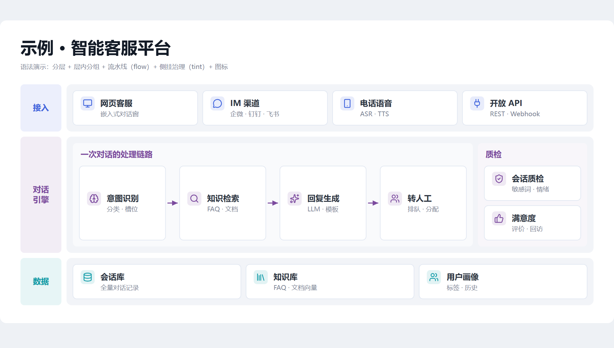
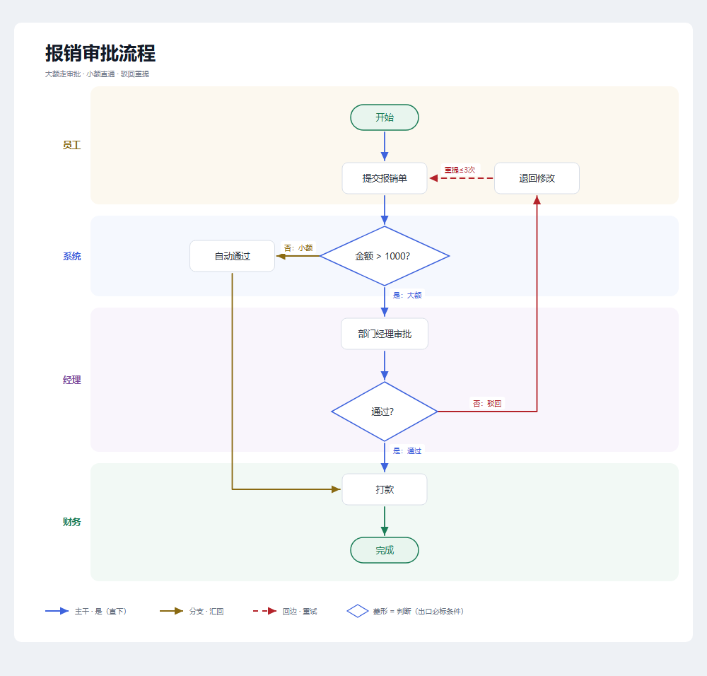

# diagram-design

用于指导 AI 绘制 **系统架构图、流程图、时序图**，支持导入 **飞书画板**。

以下截图均为模板内置示例数据的**真实渲染结果**（2x）：

**结构图**：分层 + 层内分组 + 流水线 + 侧挂治理 + 图标

**流程图**：主干直行 + 责任带 + 判断出口标签 + 回边虚线

**泳道时序图**：角色胶囊 + 阶段分区带 + 回流虚线 + 自处理括号

