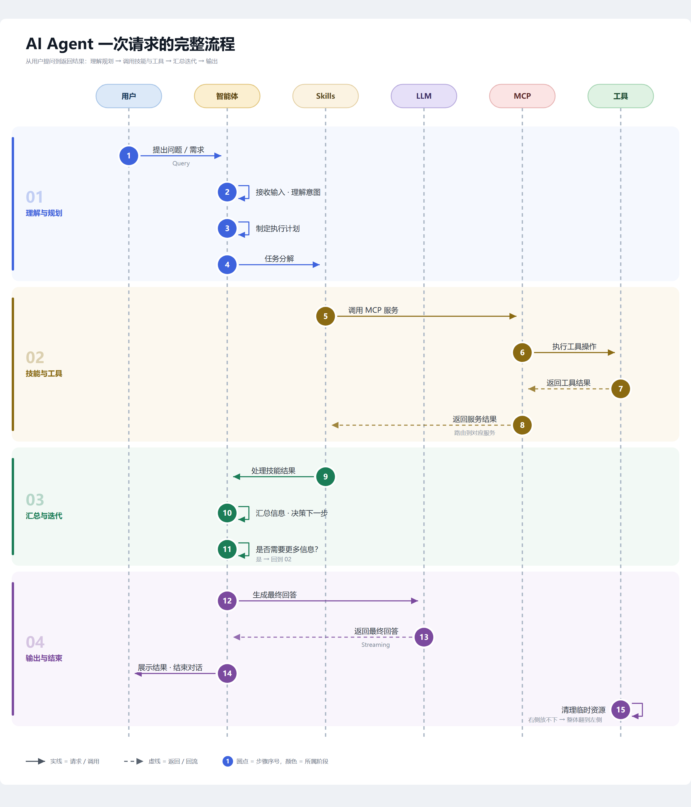

# diagram-design

用于指导 AI 绘制 **系统架构图、流程图、时序图**，支持导入 **飞书画板**。

截图均为模板内置示例数据的**真实渲染**（2x）：

| 类型 | 适用 | 示例 |
|---|---|---|
| 结构图 | 分层架构、业务域、部署分区、模块组成 |  |
| 流程图 | 业务流程、审批流、判断分支 |  |
| 泳道时序图 | 调用链、一次请求怎么走 |  |
| ~~甘特图~~ | 计划排期 · **开发中** | |

## 安装

```bash
npx -y @czasg/diagram-design@latest install
```

默认装到 `~/.claude/skills/` 和 `~/.codex/skills/`。

```bash
npx -y @czasg/diagram-design@latest install --only claude   # 只装 Claude Code
npx -y @czasg/diagram-design@latest install --dry-run       # 预览，不写文件
npx -y @czasg/diagram-design@latest list                    # 查看安装状态
npx -y @czasg/diagram-design@latest uninstall               # 卸载
```

## 使用

```
> /diagram-design 画一下我们系统的架构图
> /diagram-design 把这个审批流程画成流程图
> /diagram-design 这两个服务怎么调用的，画个泳道时序图  
```

## 要求

Node.js >= 18

## License

MIT
